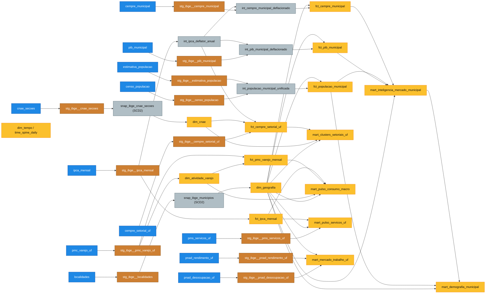

> 🌐 **Language:** [Português (BR)](README.md) | **English** · [Full Documentation (Diátaxis)](docs/en/README.md) · [ADRs](docs/decisions/README.md) · [Changelog](CHANGELOG.md) · [Agent Guide](AGENTS.md)

# SidraLake — IBGE Market Intelligence 360 (`v0.5.0`)

**SidraLake** is a local-first Data Engineering and **BI as Code** platform built on the **Medallion Architecture (`Bronze → Silver → Gold`)** for **360° Market Intelligence** across 12 official **IBGE** (Brazilian Institute of Geography and Statistics) data sources (Localities, CNAE 2.0, Municipal GDP, 2022 Census, Population Estimates, Municipal & Sectoral CEMPRE Business Registry, IPCA Inflation, Monthly Retail Survey - PMC, Monthly Services Survey - PMS, and Quarterly PNAD Contínua).

The platform combines **Delta Lake** (ACID storage with Time Travel and idempotent partitions), **DuckDB + `dbt-duckdb`** (Silver/SCD Type 2/Gold modeling via `delta_scan()`, enforced model contracts, and dbt Semantic Layer), **Polars + Pandera + Pydantic v2** (quality gates and lazy analytics), **Dagster** (unified orchestration across 49 assets and 204 checks), and **Evidence.dev + DuckDB-WASM** (responsive desktop/mobile 9-page BI app deployed automatically to GitHub Pages at `https://leoserpa.github.io/sidralake/`).

---

## Tech Stack

- **ACID Lakehouse (`data/`)**: Delta Lake (`deltalake`) across Bronze, Silver, and Gold layers (`_delta_log`, `replace_where`, `OPTIMIZE`, `VACUUM`).
- **Analytical Engine, Contracts & Semantic Layer (`dbt_project/`)**: DuckDB + `dbt-duckdb` (`delta_scan()`, `12` staging views, `2` SCD Type 2 snapshots via `dbt snapshot`, `4` intermediate tables, `17` Gold models including `time_spine_daily` and `6` OBT Marts with `contract: { enforced: true }`, `3` semantic models with `12` governed metrics, `193` data tests, and `11` SQL unit tests).
- **Ingestion & Lazy Analytics (`src/ibge_market_intel/`)**: Python `>=3.12,<3.14` (`uv`), asynchronous `httpx` with `asyncio.Semaphore` concurrency and adaptive UF/half-year chunking, `tenacity` backoff with jitter, Pydantic v2, **Polars Lazy API** (`scan_delta`, ZSTD BI Parquet exports), and Pandera.
- **Orchestration & Lineage**: Dagster (`dagster-dbt`, `49` materializable assets, `204` Asset Checks, `3` jobs, annual dynamic partitions for all 10 SIDRA aggregates, `ibge_new_period_sensor`, and `2` schedules).
- **BI as Code & 3-Layer Guardrails (`dashboard/`)**: **Evidence.dev** (`9` pages, `38` charts with responsive HTML headers, `8` custom Svelte components, responsive desktop and `390×844` mobile layout with zero desktop JS overhead, `10` ZSTD Parquets totaling `~5.5 MB`) validated by `sidralake validate-bi` (`78` SQL queries under DuckDB-WASM `DOUBLE` coercion emulation) + headless Chromium `smoke_test_build.mjs`.
- **Quality & Documentation**: JSON `structlog`, `ruff`, `mypy --strict`, `sqlfluff`, `pytest` (`34` unit + `2` integration), GitHub Actions CI + automated monthly Pages deployment (`.github/workflows/pages.yml`), and `scripts/check_doc_drift.py`.

---

## dbt & Bronze Lineage DAG



> **Legend:** 🔵 **Bronze Delta Sources** · 🟤 **Staging (`stg_*`)** · ⚪ **Intermediate (`int_*`) & SCD2 Snapshots** · 🟡 **Gold Layer (Dimensions, Facts, Marts & Semantic Layer)**

---

## Quick Start

```bash
uv sync --dev                                    # Creates .venv via uv and installs dependencies
uv run sidralake run --mode smoke                # Fast smoke run (SP/MT) Bronze -> Silver -> Gold + Delta
uv run sidralake run --mode full                 # Full Brazil load (5,571 municipalities, 2018+ dynamic)
uv run sidralake export-bi                       # Exports 10 Gold tables as ZSTD Parquet for Evidence.dev BI
uv run sidralake validate-bi                     # Validates static contracts + 78 SQL queries (DuckDB-WASM emulation)
```

---

## Commands Reference

| Command | Purpose |
| :--- | :--- |
| `make setup` | Installs Python dev dependencies (`uv sync --dev`) and dbt packages (`dbt deps`) |
| `uv run sidralake run --mode {smoke,full}` | Runs async IBGE ingestion, Pandera validation, `dbt build`, and Delta exports |
| `uv run sidralake insights --top 10` | Prints instant market rankings via Polars Lazy API (`scan_delta`) over Gold Delta tables |
| `uv run sidralake export-bi` | Exports ZSTD Parquets (`dashboard/parquet_data/`) for Evidence.dev |
| `uv run sidralake validate-bi --check-build` | Validates static contracts, 78 SQL queries, and built static assets in `dashboard/build/` |
| `uv run sidralake inspect` | Runs DuckDB sanity-check queries and reports Gold Delta Lake versions |
| `uv run sidralake maintain` | Runs `OPTIMIZE` compaction and `VACUUM` (>168h retention) across Delta layers |
| `make test` | Runs `ruff`, `mypy src`, `pytest` (`34` unit + `2` integration), and `11` dbt SQL unit tests |
| `make sql-lint` | Runs `sqlfluff lint` across dbt models, macros, and singular tests |
| `make check-docs` | Checks relative Markdown links, ADR structure, and git-ancestry documentation drift |
| `make dagster-dev` | Starts local Dagster UI at `http://127.0.0.1:3000` |
| `npm --prefix dashboard run build && npm --prefix dashboard run test:e2e` | Builds Evidence.dev static site and runs Chromium E2E checks (`1440×900` + `390×844` mobile) |

---

## Architecture & Engineering Decisions (ADRs)

Full design rationale, rejected alternatives, and measured trade-offs live in [`docs/decisions/README.md`](docs/decisions/README.md):

- [ADR-001](docs/decisions/ADR-001-local-first-medallion-delta-duckdb-dbt-dagster.md): Local-first Medallion stack (`Delta Lake` + `DuckDB` + `dbt` + `Polars` + `Pandera` + `Dagster`).
- [ADR-002](docs/decisions/ADR-002-ipca-deflation-and-winsorized-ims-scoring.md): Constant-price IPCA deflation, 2023 population linear interpolation, and winsorized IMS scoring.
- [ADR-003](docs/decisions/ADR-003-evidence-static-bi-zstd-parquet-and-3-layer-guardrails.md): Static BI in Evidence.dev (DuckDB-WASM), ZSTD Parquet export, and 3-layer guardrails.
- [ADR-004](docs/decisions/ADR-004-dynamic-period-discovery-and-dagster-partitions.md): Dynamic SIDRA period discovery, dynamic dbt calendar, and Dagster partitions.
- [ADR-005](docs/decisions/ADR-005-lightweight-mobile-layout-without-query-wrapper.md): Pure-CSS mobile layout and selective drawer reload without query wrappers (zero desktop overhead).
- [ADR-006](docs/decisions/ADR-006-strict-ibge-immediate-region-boundaries.md): Strict adherence to official IBGE immediate geographic regions for municipal peer benchmarking.

---

## Technical Documentation (Diátaxis)

All documentation follows the **Diátaxis** framework with mirrored bilingual editions (`docs/pt-br/` and `docs/en/`). Visit the [Central Documentation Hub](docs/README.md) or browse the English quadrants:

| Diátaxis Quadrant | Purpose | Document |
| :--- | :--- | :--- |
| **Tutorial** | Set up and run the end-to-end pipeline for the first time | [Getting Started](docs/en/tutorials/getting-started.md) |
| **How-to Guide** | Run full loads, surgical backfills, Time Travel, and Delta maintenance | [Backfill, Reprocessing, and Delta Maintenance](docs/en/how-to/backfill-and-reprocess.md) |
| **How-to Guide** | Recalibrate IMS weights and integrate a new SIDRA aggregate | [Tune IMS Weights and Add an IBGE Source](docs/en/how-to/tune-ims-and-add-ibge-source.md) |
| **How-to Guide** | Run local quality gates and troubleshoot common CI/BI failures | [Run Quality Gates and Troubleshoot CI](docs/en/how-to/run-quality-gates-and-ci.md) |
| **Reference** | `sidralake` CLI, `Makefile` targets, `IBGE_*` env vars, `profiles.yml`, and CI/Pages | [Configuration, CLI, and Environment](docs/en/reference/configuration-and-cli.md) |
| **Reference** | Catalog of all 12 IBGE sources, SIDRA codes, and Pydantic/Pandera contracts | [IBGE Sources and Data Contracts](docs/en/reference/ibge-sources-and-contracts.md) |
| **Reference** | Bronze/Silver/Gold dictionary, 193+11 dbt tests, and Dagster inventory (49 assets) | [Lakehouse Data Dictionary and Inventory](docs/en/reference/data-dictionary-lakehouse.md) |
| **Explanation** | Medallion architecture, BI as Code layer, and real IBGE API edge cases | [Medallion Architecture and Engineering Design](docs/en/explanation/medallion-architecture-and-design.md) |
| **Explanation** | Economic rationale behind IPCA, HHI, IMS, LQ, PMC, PMS, PNAD, and Demographics | [Market Intelligence Methodology](docs/en/explanation/market-intelligence-methodology.md) |

---

## Contributing & Standards

Before opening a pull request or editing pipelines or BI pages, read [`AGENTS.md`](AGENTS.md) for non-negotiable invariants and run:

```bash
make test && make sql-lint && make check-docs
```

See [`CHANGELOG.md`](CHANGELOG.md) for the release history.

---

## License and Data Attribution

The source code of this project is licensed under the **[GNU General Public License v3.0 (GPL-3.0)](LICENSE)**. The extracted primary data belongs to the **Brazilian Institute of Geography and Statistics (IBGE)** and is publicly accessible under the Brazilian Federal Government Open Data Policy.
