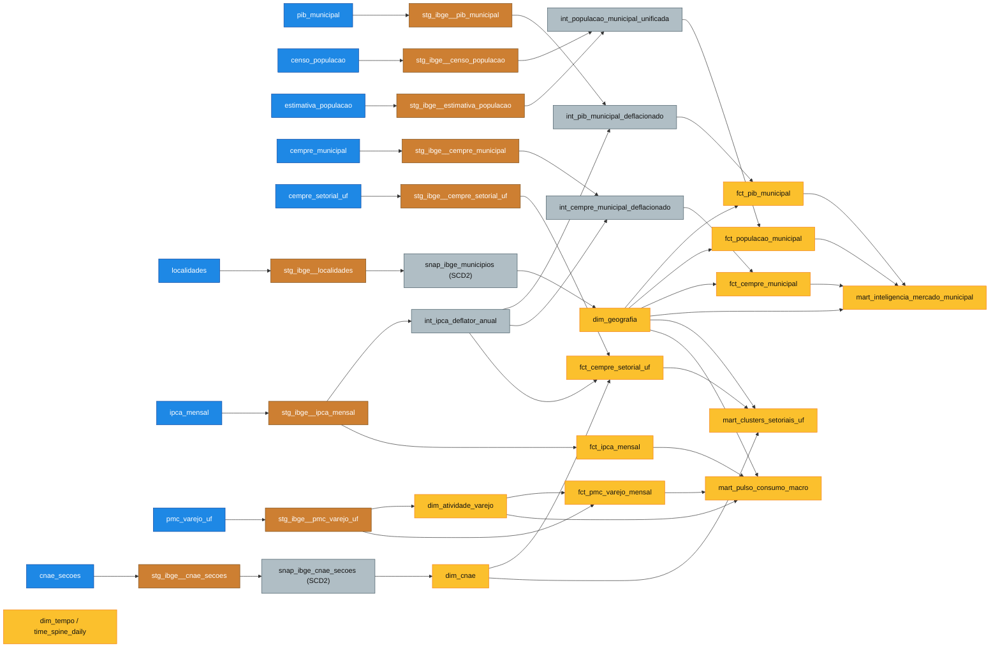

> 🌐 **Language:** [Português (BR)](README.md) | **English** · [Full Documentation (Diátaxis)](docs/en/README.md)

# SidraLake — IBGE Market Intelligence 360 (Medallion Data Pipeline)

**SidraLake** is a Data Engineering pipeline built on the **Medallion Architecture (Bronze → Silver → Gold)** for **360° Market Intelligence** powered by official **IBGE** (Brazilian Institute of Geography and Statistics) APIs (Localities, CNAE 2.0, Municipal GDP, 2022 Census, Population Estimates, Municipal & Sectoral CEMPRE Business Registry, IPCA Inflation, Monthly Retail Survey - PMC, Monthly Services Survey - PMS, and Quarterly PNAD Contínua).

The project implements a **Local-First Modern Data Stack** focused on reliability, data contracts, and governance: **Delta Lake** with ACID transactions and Time Travel, **DuckDB + dbt-duckdb** for Silver/SCD Type 2/Gold modeling, **Polars + Pandera + Pydantic v2** as ingestion quality gates, and **Dagster** for asset-oriented orchestration, partitions, freshness sensors, and end-to-end lineage.

---

## Tech Stack

- **ACID Lakehouse**: Delta Lake (`deltalake`) across Bronze, Silver, and Gold layers (`_delta_log`, `replace_where`, `MERGE`, `OPTIMIZE`, `VACUUM`)
- **Analytical Engine, Contracts & Semantic Layer**: DuckDB + `dbt-duckdb` 1.12 (`delta_scan()`, Staging, Intermediate, SCD Type 2 via `dbt snapshot`, Gold Star Schema + 3 OBT Marts with **Enforced Model Contracts** across 100% of Gold models, **dbt Semantic Layer** with 3 semantic models, 12 governed metrics, and `time_spine_daily`, **10 SQL dbt Unit Tests**, and singular accounting tests)
- **Ingestion & Lazy Analytics**: Python `>=3.12,<3.14` (`uv`), asynchronous `httpx` with semaphore concurrency and adaptive UF/semester chunking, `tenacity` exponential backoff with jitter, `Pydantic v2`, **Polars Lazy API** (`scan_delta` + deterministic Arrow IPC hashing), `Pandera[polars]`
- **Orchestration & Lineage**: Dagster (`dagster-dbt`, annual dynamic partitions, blocking Asset Checks, **Declarative Automation `AutomationCondition.eager()`** on dbt models and Delta exports, dynamic IBGE API Freshness Sensor, and Schedules)
- **BI as Code Layer**: **Evidence.dev** (`dashboard/`, 9 pages including Demographics & Regional Poles, PNAD Labor & Income, and PMS Services) in SQL + Markdown compiled to static **DuckDB-WASM** and deployed automatically to **GitHub Pages** (`https://leoserpa.github.io/sidralake/`) via `.github/workflows/pages.yml` with monthly freshness manifest
- **Quality & Observability**: `structlog` JSON logging, `ruff`, `mypy --strict`, `sqlfluff`, `pytest` (`>85%` coverage) + `respx`, GitHub Actions CI

---

## dbt Lineage DAG (from `manifest.json`)



> **Legend:** 🔵 **Bronze Delta Sources** · 🟤 **Staging (`stg_*`)** · ⚪ **Intermediate (`int_*`) & SCD2 Snapshots** · 🟡 **Gold Layer (Dimensions, Facts, Marts & Semantic Layer)**

---

## Quick Start

```bash
uv sync --dev                        # Creates .venv via uv and installs dependencies
uv run sidralake run --mode smoke    # Fast smoke run (SP/MT) Bronze -> Silver -> Gold + Delta
uv run sidralake run --mode full     # Full Brazil load (5,571 municipalities, 2018+ dynamic)
uv run sidralake insights --top 10   # Instant market rankings via Polars Lazy API (scan_delta)
uv run sidralake export-bi           # Exports Gold Marts as Snappy Parquet for Evidence.dev BI
uv run sidralake inspect             # Full sanity check against DuckDB and Gold Delta Lake
uv run sidralake test                # Runs ruff, mypy, pytest (unit + E2E), and 10 dbt unit tests
make dagster-dev                     # Starts Dagster UI (assets, partitions, blocking checks)
```

---

## Technical Documentation (Diátaxis)

All documentation follows the **Diátaxis** framework with mirrored bilingual editions (`docs/pt-br/` and `docs/en/`). Visit the [Central Documentation Hub](docs/README.md) or browse the English quadrants directly:

| Diátaxis Quadrant | Purpose | Document |
| :--- | :--- | :--- |
| **Tutorial** | Hands-on walkthrough to set up and run the pipeline for the first time | [Getting Started](docs/en/tutorials/getting-started.md) |
| **How-to Guide** | Run full loads, surgical partition backfills, Time Travel, and Delta maintenance | [Backfill, Reprocessing, and Delta Maintenance](docs/en/how-to/backfill-and-reprocess.md) |
| **How-to Guide** | Recalibrate IMS Score weights and integrate a new SIDRA aggregate | [Tune IMS Weights and Add an IBGE Source](docs/en/how-to/tune-ims-and-add-ibge-source.md) |
| **How-to Guide** | Run local quality gates and troubleshoot common pipeline failures | [Run Quality Gates and Troubleshoot CI](docs/en/how-to/run-quality-gates-and-ci.md) |
| **Reference** | `ibge-pipeline` CLI, `Makefile` targets, `IBGE_*` env vars, `profiles.yml`, and CI | [Configuration, CLI, and Environment](docs/en/reference/configuration-and-cli.md) |
| **Reference** | Catalog of all 9 IBGE sources, SIDRA special codes, and Pydantic/Pandera contracts | [IBGE Sources and Data Contracts](docs/en/reference/ibge-sources-and-contracts.md) |
| **Reference** | Bronze/Silver/Gold data dictionary, dbt tests, and Dagster inventory | [Lakehouse Data Dictionary and Inventory](docs/en/reference/data-dictionary-lakehouse.md) |
| **Explanation** | Medallion design decisions, resilience patterns, and real IBGE edge cases | [Medallion Architecture and Engineering Design](docs/en/explanation/medallion-architecture-and-design.md) |
| **Explanation** | Economic and statistical rationale behind IPCA deflation, HHI, IMS, LQ, and PMC | [Market Intelligence Methodology](docs/en/explanation/market-intelligence-methodology.md) |

---

## License and Data Attribution

The source code of this project is licensed under the **[GNU General Public License v3.0 (GPL-3.0)](LICENSE)**. The extracted primary data belongs to the **Brazilian Institute of Geography and Statistics (IBGE)** and is publicly accessible under the Brazilian Federal Government Open Data Policy.
