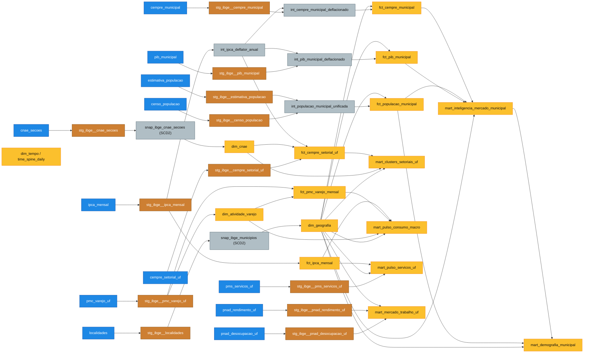

> 🌐 **Idioma:** **Português (BR)** | [English](README.en.md) · [Documentação Completa (Diátaxis)](docs/pt-br/README.md) · [ADRs](docs/decisions/README.md) · [Changelog](CHANGELOG.md) · [Guia para Agentes](AGENTS.md)

# SidraLake — Inteligência de Mercado IBGE 360 (`v0.5.0`)

**SidraLake** é uma plataforma local-first de Engenharia de Dados e **BI as Code** construída em **Arquitetura Medalhão (`Bronze → Silver → Gold`)** para **Inteligência de Mercado 360°** sobre 12 fontes oficiais do **IBGE** (Localidades, CNAE 2.0, PIB Municipal, Censo Demográfico 2022, Estimativas Populacionais, CEMPRE Municipal e Setorial, IPCA, Pesquisa Mensal de Comércio - PMC, Pesquisa Mensal de Serviços - PMS e PNAD Contínua Trimestral).

O pipeline combina **Delta Lake** (armazenamento ACID com Time Travel e partições idempotentes), **DuckDB + `dbt-duckdb`** (modelagem Silver/SCD Tipo 2/Gold com `delta_scan()`, contratos obrigatórios e Camada Semântica), **Polars + Pandera + Pydantic v2** (validação e analytics lazy), **Dagster** (orquestração unificada de 49 ativos e 204 checks) e **Evidence.dev + DuckDB-WASM** (dashboard responsivo desktop/mobile de 9 páginas publicado no GitHub Pages em `https://leoserpa.github.io/sidralake/`).

---

## Tecnologias Utilizadas

- **Lakehouse ACID (`data/`)**: Delta Lake (`deltalake`) nas camadas Bronze, Silver e Gold (`_delta_log`, `replace_where`, `OPTIMIZE`, `VACUUM`).
- **Motor Analítico, Contratos & Camada Semântica (`dbt_project/`)**: DuckDB + `dbt-duckdb` (`delta_scan()`, `12` views staging, `2` snapshots SCD Tipo 2 via `dbt snapshot`, `4` tabelas intermediate, `17` modelos Gold incluindo `time_spine_daily` e `6` Data Marts OBT com `contract: { enforced: true }`, `3` modelos semânticos com `12` métricas governadas, `193` testes de dados e `11` testes unitários SQL).
- **Ingestão & Consultas Lazy (`src/ibge_market_intel/`)**: Python `>=3.12,<3.14` (`uv`), `httpx` assíncrono com `asyncio.Semaphore` e fatiamento adaptativo por UF/semestre, `tenacity` backoff com jitter, Pydantic v2, **Polars Lazy API** (`scan_delta`, exports BI ZSTD) e Pandera.
- **Orquestração & Linhagem**: Dagster (`dagster-dbt`, `49` ativos materializáveis, `204` Asset Checks, `3` jobs, partições dinâmicas anuais para os 10 agregados SIDRA, sensor `ibge_new_period_sensor` e `2` agendamentos).
- **BI as Code & Guardrails em 3 Camadas (`dashboard/`)**: **Evidence.dev** (`9` páginas, `38` gráficos em cabeçalho HTML responsivo, `8` componentes Svelte customizados, layout desktop e mobile `390×844` sem overhead no desktop, `10` Parquets ZSTD somando `~5,5 MB`) validado por `sidralake validate-bi` (`78` queries SQL sob emulação `DOUBLE` do DuckDB-WASM) + `smoke_test_build.mjs` em Chromium headless.
- **Qualidade & Documentação**: `structlog` JSON, `ruff`, `mypy --strict`, `sqlfluff`, `pytest` (`34` unitários + `2` integração), GitHub Actions CI + Deploy mensal automatizado (`.github/workflows/pages.yml`) e `scripts/check_doc_drift.py`.

---

## Linhagem da DAG (dbt + Fontes Bronze)



> **Legenda:** 🔵 **Fontes Bronze Delta** · 🟤 **Staging (`stg_*`)** · ⚪ **Intermediate (`int_*`) & Snapshots SCD2** · 🟡 **Camada Gold (Dimensões, Fatos, Marts & Camada Semântica)**

---

## Início Rápido

```bash
uv sync --dev                                    # Cria .venv com uv e instala dependencias
uv run sidralake run --mode smoke                # Validacao rapida (SP/MT) Bronze -> Silver -> Gold + Delta
uv run sidralake run --mode full                 # Carga completa Brasil (5.571 municipios, 2018+ dinamico)
uv run sidralake export-bi                       # Exporta 10 tabelas Gold em Parquet ZSTD para o dashboard BI
uv run sidralake validate-bi                     # Valida contratos estaticos + 78 queries SQL (emulacao DuckDB-WASM)
```

---

## Comandos Principais

| Comando | Propósito |
| :--- | :--- |
| `make setup` | Instala dependências Python (`uv sync --dev`) e pacotes dbt (`dbt deps`) |
| `uv run sidralake run --mode {smoke,full}` | Executa ingestão assíncrona IBGE, validação Pandera, `dbt build` e exportação Delta |
| `uv run sidralake insights --top 10` | Gera rankings imediatos via Polars Lazy API (`scan_delta`) na camada Gold |
| `uv run sidralake export-bi` | Exporta Parquets ZSTD (`dashboard/parquet_data/`) para o dashboard Evidence.dev |
| `uv run sidralake validate-bi --check-build` | Valida contratos estáticos, 78 queries SQL e artefatos de build em `dashboard/build/` |
| `uv run sidralake inspect` | Executa checagens analíticas no DuckDB e lista versões Delta Lake Gold |
| `uv run sidralake maintain` | Compacta arquivos (`OPTIMIZE`) e remove órfãos >168h (`VACUUM`) nas camadas Delta |
| `make test` | Roda `ruff`, `mypy src`, `pytest` (`34` unitários + `2` integração) e `11` testes unitários SQL do dbt |
| `make sql-lint` | Executa `sqlfluff lint` em modelos, macros e testes singulares SQL |
| `make check-docs` | Valida links Markdown, estrutura de ADRs e drift de documentação via Git |
| `make dagster-dev` | Sobe a UI Dagster local em `http://127.0.0.1:3000` |
| `npm --prefix dashboard run build && npm --prefix dashboard run test:e2e` | Gera o site estático Evidence.dev e executa auditoria Chromium (`1440×900` + `390×844` mobile) |

---

## Arquitetura & Decisões de Design (ADRs)

O racional completo, alternativas rejeitadas e trade-offs medidos do projeto estão registrados em [`docs/decisions/README.md`](docs/decisions/README.md):

- [ADR-001](docs/decisions/ADR-001-local-first-medallion-delta-duckdb-dbt-dagster.md): Stack Medalhão Local-First (`Delta Lake` + `DuckDB` + `dbt` + `Polars` + `Pandera` + `Dagster`).
- [ADR-002](docs/decisions/ADR-002-ipca-deflation-and-winsorized-ims-scoring.md): Deflação pelo IPCA, interpolação linear de 2023 e Score IMS winsorizado.
- [ADR-003](docs/decisions/ADR-003-evidence-static-bi-zstd-parquet-and-3-layer-guardrails.md): BI estático em Evidence.dev (DuckDB-WASM), Parquet ZSTD e guardrails em 3 camadas.
- [ADR-004](docs/decisions/ADR-004-dynamic-period-discovery-and-dagster-partitions.md): Descoberta dinâmica de períodos SIDRA, calendário dinâmico e partições Dagster.
- [ADR-005](docs/decisions/ADR-005-lightweight-mobile-layout-without-query-wrapper.md): Layout mobile leve em CSS puro e `data-sveltekit-reload` apenas no menu mobile (zero impacto no desktop).
- [ADR-006](docs/decisions/ADR-006-strict-ibge-immediate-region-boundaries.md): Aderência estrita às Regiões Geográficas Imediatas oficiais do IBGE no benchmark municipal.

---

## Documentação Técnica (Diátaxis)

Toda a documentação segue o framework **Diátaxis** em versões bilíngues espelhadas (`docs/pt-br/` e `docs/en/`). Veja o [Portal Central de Documentação](docs/README.md) ou navegue pelos documentos em Português:

| Quadrante Diátaxis | Propósito | Documento |
| :--- | :--- | :--- |
| **Tutorial** | Subir e executar o pipeline ponta a ponta pela primeira vez | [Primeiros Passos](docs/pt-br/tutoriais/primeiros-passos.md) |
| **Guia Prático** | Carga completa, backfill cirúrgico, histórico Delta e manutenção | [Backfill, Reprocessamento e Manutenção Delta](docs/pt-br/guias-praticos/backfill-e-reprocessamento.md) |
| **Guia Prático** | Recalibrar pesos do Score IMS e integrar novo agregado SIDRA | [Ajustar Pesos do IMS e Adicionar Fonte IBGE](docs/pt-br/guias-praticos/ajustar-ims-e-adicionar-fonte-ibge.md) |
| **Guia Prático** | Executar portões de qualidade locais e diagnosticar falhas de CI | [Executar Portões de Qualidade e Diagnosticar Falhas](docs/pt-br/guias-praticos/portoes-de-qualidade-e-ci.md) |
| **Referência** | CLI `sidralake`, alvos do `Makefile`, `IBGE_*`, `profiles.yml` e workflows CI/Pages | [Configuração, CLI e Ambiente](docs/pt-br/referencia/configuracao-e-cli.md) |
| **Referência** | Catálogo das 12 fontes IBGE, códigos especiais SIDRA e contratos Pydantic/Pandera | [Fontes IBGE e Contratos de Dados](docs/pt-br/referencia/fontes-ibge-e-contratos.md) |
| **Referência** | Dicionário Bronze/Silver/Gold, 193+11 testes dbt e inventário Dagster (49 ativos) | [Dicionário de Dados e Inventário do Lakehouse](docs/pt-br/referencia/dicionario-de-dados-lakehouse.md) |
| **Explicação** | Arquitetura Medalhão, camada BI as Code e casos de borda reais do IBGE | [Arquitetura Medalhão e Decisões de Engenharia](docs/pt-br/explicacoes/arquitetura-medalhao-e-design.md) |
| **Explicação** | Racional econômico de IPCA, HHI, IMS, QL, PMC, PMS, PNAD e Demografia | [Metodologia de Inteligência de Mercado](docs/pt-br/explicacoes/metodologia-inteligencia-de-mercado.md) |

---

## Contribuição e Padrões

Antes de abrir um PR ou modificar pipelines e páginas BI, consulte [`AGENTS.md`](AGENTS.md) para invariantes do projeto e execute:

```bash
make test && make sql-lint && make check-docs
```

Consulte também o histórico completo de entregas em [`CHANGELOG.md`](CHANGELOG.md).

---

## Licença e Fonte dos Dados

O código-fonte deste projeto é licenciado sob a **[GNU General Public License v3.0 (GPL-3.0)](LICENSE)**. Os dados primários extraídos pertencem ao **Instituto Brasileiro de Geografia e Estatística (IBGE)** e são de acesso público nos termos da Política de Dados Abertos do Governo Federal.
