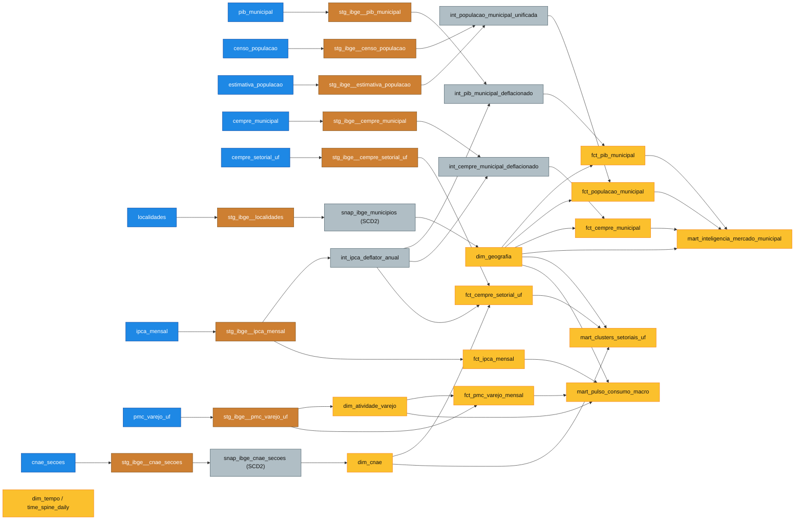

> 🌐 **Idioma:** **Português (BR)** | [English](README.en.md) · [Documentação Completa (Diátaxis)](docs/pt-br/README.md)

# SidraLake — Inteligência de Mercado IBGE 360 (Pipeline de Dados Medalhão)

**SidraLake** é um pipeline de Engenharia de Dados em **Arquitetura Medalhão (Bronze → Silver → Gold)** para **Inteligência de Mercado 360°** com dados oficiais do **IBGE** (Localidades, CNAE 2.0, PIB Municipal, Censo Demográfico 2022, Estimativas Populacionais, CEMPRE Municipal/Setorial, IPCA e Pesquisa Mensal de Comércio - PMC).

O projeto adota uma **Arquitetura de Dados Moderna Local-First** com foco em confiabilidade, contratos de dados e governança: **Delta Lake** com transações ACID e histórico temporal (*Time Travel*), **DuckDB + dbt-duckdb** para modelagem Silver/SCD Tipo 2/Gold, **Polars + Pandera + Pydantic v2** como barreiras de qualidade na ingestão e **Dagster** para orquestração orientada a ativos (*assets*), partições, sensores de frescor e linhagem ponta a ponta.

---

## Tecnologias Utilizadas

- **Lakehouse ACID**: Delta Lake (`deltalake`) nas camadas Bronze, Silver e Gold (`_delta_log`, `replace_where`, `MERGE`, `OPTIMIZE`, `VACUUM`)
- **Motor Analítico, Contratos & Camada Semântica**: DuckDB + `dbt-duckdb` 1.12 (`delta_scan()`, Staging, Intermediate, SCD Tipo 2 via `dbt snapshot`, Esquema Estrela + 3 Data Marts OBT com **Contratos Obrigatórios** em 100% da camada Gold, **dbt Semantic Layer** com 3 modelos semânticos, 12 métricas governadas e `time_spine_daily`, **10 testes unitários SQL** e testes singulares contábeis)
- **Ingestão & Consultas Lazy**: Python `>=3.12,<3.14` (`uv`), `httpx` assíncrono com semáforo e fatiamento adaptativo por UF/semestre, `tenacity` backoff com jitter, `Pydantic v2`, **Polars Lazy API** (`scan_delta` + hash determinístico Arrow IPC), `Pandera[polars]`
- **Orquestração & Linhagem**: Dagster (`dagster-dbt`, partições estáticas anuais, Verificações de Ativos bloqueantes, **Declarative Automation `AutomationCondition.eager()`**, Sensor de Frescor blindado na API do IBGE e Agendamentos)
- **Qualidade & Observabilidade**: `structlog` JSON, `ruff`, `mypy --strict`, `sqlfluff`, `pytest` (`>85%` de cobertura) + `respx`, GitHub Actions CI

---

## Linhagem da DAG (dbt Manifest)



> **Legenda:** 🔵 **Fontes Bronze Delta** · 🟤 **Staging (`stg_*`)** · ⚪ **Intermediate (`int_*`) & Snapshots SCD2** · 🟡 **Camada Gold (Dimensões, Fatos, Marts & Camada Semântica)**

---

## Início Rápido

```bash
uv sync --dev                        # Cria .venv com uv e instala dependencias
uv run sidralake run --mode smoke    # Validacao rapida (SP/MT) Bronze -> Silver -> Gold + Delta
uv run sidralake run --mode full     # Carga completa Brasil (5.571 municipios, 2018-2026)
uv run sidralake insights --top 10   # Rankings imediatos via Polars Lazy API (scan_delta) na Gold
uv run sidralake inspect             # Sanity check completo no DuckDB e Delta Lake Gold
uv run sidralake test                # Roda ruff, mypy, pytest (unitario + E2E) e 10 dbt unit tests
make dagster-dev                     # Sobe a interface Dagster (ativos, particoes, verificacoes)
```

---

## Documentação Técnica (Diátaxis)

Toda a documentação está organizada segundo o framework **Diátaxis** em versões bilíngues espelhadas (`docs/pt-br/` e `docs/en/`). Veja o [Portal Central de Documentação](docs/README.md) ou navegue diretamente pelos quadrantes em Português:

| Quadrante Diátaxis | Propósito | Documento |
| :--- | :--- | :--- |
| **Tutorial** | Aprender na prática subindo e executando o pipeline pela primeira vez | [Primeiros Passos](docs/pt-br/tutoriais/primeiros-passos.md) |
| **Guia Prático** | Executar carga completa, backfill cirúrgico, histórico Delta e manutenção | [Backfill, Reprocessamento e Manutenção Delta](docs/pt-br/guias-praticos/backfill-e-reprocessamento.md) |
| **Guia Prático** | Recalibrar pesos do Score IMS e integrar um novo agregado SIDRA | [Ajustar Pesos do IMS e Adicionar Fonte IBGE](docs/pt-br/guias-praticos/ajustar-ims-e-adicionar-fonte-ibge.md) |
| **Guia Prático** | Rodar portões de qualidade localmente e diagnosticar falhas comuns | [Executar Portões de Qualidade e Diagnosticar Falhas](docs/pt-br/guias-praticos/portoes-de-qualidade-e-ci.md) |
| **Referência** | CLI `ibge-pipeline`, alvos do `Makefile`, variáveis `IBGE_*`, `profiles.yml` e CI | [Configuração, CLI e Ambiente](docs/pt-br/referencia/configuracao-e-cli.md) |
| **Referência** | Catálogo das 9 fontes IBGE, códigos especiais SIDRA e contratos Pydantic/Pandera | [Fontes IBGE e Contratos de Dados](docs/pt-br/referencia/fontes-ibge-e-contratos.md) |
| **Referência** | Dicionário das camadas Bronze/Silver/Gold, testes dbt e grafo Dagster | [Dicionário de Dados e Inventário do Lakehouse](docs/pt-br/referencia/dicionario-de-dados-lakehouse.md) |
| **Explicação** | Decisões de arquitetura Medalhão, resiliência e casos de borda reais do IBGE | [Arquitetura Medalhão e Decisões de Engenharia](docs/pt-br/explicacoes/arquitetura-medalhao-e-design.md) |
| **Explicação** | Racional econômico e estatístico de IPCA, HHI, Score IMS, QL e PMC | [Metodologia de Inteligência de Mercado](docs/pt-br/explicacoes/metodologia-inteligencia-de-mercado.md) |

---

## Licença e Fonte dos Dados

O código-fonte deste projeto é licenciado sob a **[GNU General Public License v3.0 (GPL-3.0)](LICENSE)**. Os dados primários extraídos pertencem ao **Instituto Brasileiro de Geografia e Estatística (IBGE)** e são de acesso público nos termos da Política de Dados Abertos do Governo Federal.
