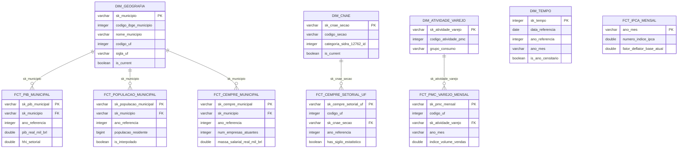

> 🌐 **Language:** [Português (BR)](../../pt-br/explicacoes/arquitetura-medalhao-e-design.md) | **English** · [Index](../README.md)

# Medallion Architecture and Engineering Design

This document explains the architectural rationale behind the **Bronze → Silver → Gold** pipeline, the local-first technology stack, resilience and idempotency mechanisms, and real-world IBGE API edge cases addressed by the design.

---

## 1. End-to-End Architecture Overview

```mermaid
flowchart LR
    subgraph SRC["Official IBGE APIs"]
        A1["Localities v1 and CNAE v2"]
        A2["Annual SIDRA v3 (5938, 4714, 6579, 9509, 9418)"]
        A3["Monthly SIDRA v3 (1737, 8883)"]
    end

    subgraph ING["Ingestion and Quality Gates"]
        I1["IBGEAsyncClient (httpx + Semaphore + Tenacity)"]
        I2["Pydantic v2 + Deterministic Flatten"]
        I3["Pandera Asset Checks (Circuit Breakers)"]
    end

    subgraph BRONZE["Bronze Layer (Delta Lake ACID)"]
        B1["data/bronze/* (Partitioned by ano_referencia)"]
    end

    subgraph SILVER["Silver Layer (DuckDB + dbt)"]
        S1["Staging Views (parse_ibge_value and Deduplication)"]
        S2["SCD Type 2 Snapshots (Municipalities and CNAE)"]
        S3["Intermediate Tables (Population, IPCA Deflator, GDP, CEMPRE)"]
    end

    subgraph GOLD["Gold Layer (Star Schema + OBTs + Delta)"]
        G1["Dimensions and Facts (Enforced Contracts)"]
        G2["OBT Marts (IMS, LQ Clusters, PMC Pulse)"]
        G3["ACID Arrow Export to data/silver and data/gold"]
    end

    SRC --> I1 --> I2 --> B1 --> I3
    I3 --> S1 --> S2 --> G1
    S1 --> S3 --> G1 --> G2 --> G3
```

---

## 2. Why This Local-First Stack (`Delta Lake + DuckDB + dbt + Dagster`)

1. **Decoupled open-table storage and compute**: Bronze writes to **Delta Lake** (`deltalake` / delta-rs), avoiding proprietary lock-in. DuckDB reads Parquet files directly through `delta_scan()` inside `dbt-duckdb` with zero intermediate staging copies.
2. **Zero-copy Arrow export**: after `dbt build`, `assets_gold_export.py` extracts Silver and Gold tables via `.to_arrow_table()` and persists them as ACID Delta Lake tables under `data/silver/` and `data/gold/`, enabling direct consumption by DuckDB or any Delta-compatible engine.
3. **Production discipline without heavy infrastructure**: the entire stack runs natively in Python 3.12 via `uv` (a full national run across 5,571 municipalities for 2018–2026 completes in ~108 seconds) while enforcing production engineering rigor: **enforced model contracts**, **SCD Type 2**, **declarative partitioning**, and **unified Python + SQL lineage**.

---

## 3. Gold Dimensional Model (Star Schema)

---

## 4. Resilience, Idempotency, and Write-Audit-Publish

### 4.1 Adaptive Chunking and Concurrency Control
Wide municipal queries (`N6[all]`) with many variables—such as CEMPRE `9509` (8 variables × 5,570 municipalities)—hit timeouts (>30s) on the SIDRA backend. `IBGEAsyncClient` splits municipal aggregates into **27 concurrent state queries (`N6[N3[uf]]`)** and multi-classification monthly retail queries (PMC `8883`) into **6-month chunks**. An `asyncio.Semaphore(6)` bounds concurrency while `tenacity` retries only transient failures (`408`, `429`, `5xx`, timeouts, and network errors) using exponential backoff with jitter.

### 4.2 Partition Idempotency (`replace_where`) and Deterministic Hashing
Re-running any year or triggering backfills never introduces duplicates:
1. SIDRA partitions use `write_partition_overwrite` with `predicate="ano_referencia = '<year>'"`, atomically replacing only the target partition in Delta Lake.
2. `DeltaLakeWriter` records a deterministic SHA-256 `_payload_hash` over sorted business columns and keeps full commit history in `_delta_log` for Time Travel audits.
3. Silver staging views apply defensive deduplication (`qualify row_number() over (... order by _ingested_at_utc desc) = 1`).

### 4.3 Layered "Shift-Left" Quality Gates
- **HTTP boundary (Pydantic v2)**: rejects malformed JSON before tabular flattening.
- **Bronze boundary (Pandera + `@asset_check(blocking=True)`)**: halts promotion to dbt if duplicate keys or unexpected value tokens appear.
- **Gold boundary (Enforced dbt Model Contracts + Singular Tests)**: guarantees immutable column types and macroeconomic invariants (`GDP = Total GVA + Net Taxes`, sector GVA reconciliation, and zero `NaN`/`Inf` scores).

### 4.4 Historical Tracking with SCD Type 2
Brazilian municipalities undergo name updates, new emancipations, and regional boundary updates. Using `dbt snapshot` (`snap_ibge_municipios` and `snap_ibge_cnae_secoes`), changes close out the previous record (`valid_to`) and insert a new active version (`is_current = true`), preserving referential accuracy for historical facts tied to `sk_municipio` and `sk_cnae_secao`.

---

## 5. Real IBGE Edge Cases and Design Decisions

1. ***Boa Esperança do Norte/MT* (`5101837`) with `microrregiao = null`**: this newly established municipality returns `"microrregiao": null` on the Localities API, while `"regiao-imediata"` is populated. We derive `UF`, `regiao`, and `regiao-intermediaria` exclusively from `regiao-imediata`, keeping `microrregiao_*` and `mesorregiao_*` nullable.
2. **CEMPRE 2022 methodological break**: aggregate `1685` ended in 2021 and was replaced by `9509` / `9418` starting in 2022 following eSocial/RFB integration. To prevent artificial discontinuities in growth metrics, the pipeline consumes only the **active 2022+ series** rather than splicing incompatible series.
3. **Preserving semantics of `-`, `..`, `...`, and `X`**: blindly casting every non-numeric SIDRA symbol to `NULL` conflates an **exact zero (`-`)**, **statistical confidentiality (`X`)**, and **unavailable data (`...`)**. Bronze keeps `valor_bruto` raw as a string while Silver separates `valor_numerico` from `status_valor_ibge`, propagating `has_sigilo_estatistico` to Gold.
4. **Empty `unidade` strings in SIDRA `5938`**: caught live by the Pandera Circuit Breaker on 2022 GDP data; the contract allows empty/nullable `unidade` strings while keeping strict validation on values and natural keys.
