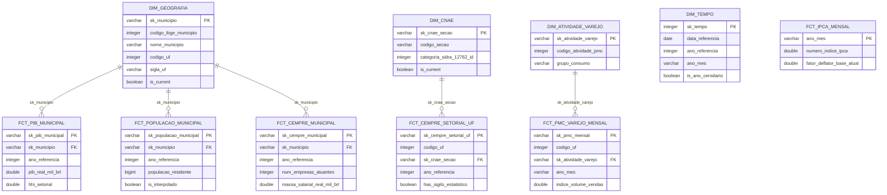

> 🌐 **Idioma:** **Português (BR)** | [English](../../en/explanation/medallion-architecture-and-design.md) · [Índice](../README.md)

# Arquitetura Medalhão e Decisões de Engenharia

Este documento explica o raciocínio por trás da arquitetura **Bronze → Silver → Gold**, da escolha da stack local-first e das soluções adotadas para resiliência, idempotência e *edge cases* reais das APIs do IBGE.

---

## 1. Visão Ponta a Ponta da Arquitetura

```mermaid
flowchart LR
    subgraph SRC["Fontes Oficiais IBGE (12 APIs)"]
        A1["Localidades v1 e CNAE v2"]
        A2["SIDRA v3 Anual (5938, 4714, 6579, 9509, 9418)"]
        A3["SIDRA v3 Mensal/Trimestral (1737, 8883, 5906, 4099, 5436)"]
    end

    subgraph ING["Ingestao e Barreiras de Qualidade"]
        I1["IBGEAsyncClient (httpx + Semaphore + Tenacity)"]
        I2["Pydantic v2 + Flatten Deterministico"]
        I3["Pandera Asset Checks (12 Circuit Breakers)"]
    end

    subgraph BRONZE["Camada Bronze (Delta Lake ACID)"]
        B1["data/bronze/* (12 tabelas particionadas por ano_referencia)"]
    end

    subgraph SILVER["Camada Silver (DuckDB + dbt)"]
        S1["12 Staging Views (parse_ibge_value e Deduplicacao)"]
        S2["2 Snapshots SCD Type 2 (Municipios e CNAE)"]
        S3["4 Intermediate Tables (Populacao, Deflator IPCA, PIB, CEMPRE)"]
    end

    subgraph GOLD["Camada Gold (Star Schema + OBTs + Delta)"]
        G1["5 Dimensoes + 6 Fatos (Contratos Enforced)"]
        G2["6 Marts OBT (IMS, Clusters QL, PMC, PMS, PNAD, Demografia)"]
        G3["Export ACID Arrow para data/silver e data/gold"]
    end

    subgraph BI["BI as Code (Evidence.dev + DuckDB-WASM)"]
        BI1["bi_export.py -> 10 Parquets ZSTD (~5,5 MB)"]
        BI2["dashboard_guard.py + Chromium E2E -> GitHub Pages"]
    end

    SRC --> I1 --> I2 --> B1 --> I3
    I3 --> S1 --> S2 --> G1
    S1 --> S3 --> G1 --> G2 --> G3 --> BI1 --> BI2
```

---

## 2. Por Que a Arquitetura Local-First (`Delta Lake + DuckDB + dbt + Dagster`)

1. **Desacoplamento de armazenamento e computação em formato aberto**: a camada Bronze grava em **Delta Lake** (`deltalake` / delta-rs), evitando aprisionamento a um banco proprietário. O DuckDB lê os arquivos Parquet diretamente via `delta_scan()` dentro do `dbt-duckdb` sem etapa intermediária de cópia para staging.
2. **Exportação zero-copy via Apache Arrow**: ao final do `dbt build`, o módulo `assets_gold_export.py` extrai tabelas Silver e Gold do DuckDB usando `.to_arrow_table()` e grava em `data/silver/` e `data/gold/` como tabelas Delta ACID, permitindo consumo tanto via SQL DuckDB quanto por motores compatíveis com Delta Lake.
3. **Execução sem infraestrutura pesada**: toda a stack roda nativamente em Python 3.12 com `uv` em segundos (a carga nacional completa de 5.571 municípios, 2018–2026, leva cerca de 108 segundos), preservando padrões de produção como **contratos *enforced***, **SCD Type 2**, **particionamento** e **linhagem unificada Python + SQL**.

---

## 3. Modelo Dimensional Gold (Esquema Estrela)

---

## 4. Resiliência, Idempotência e Governança (Escrita, Auditoria e Publicação)

### 4.1 Chunking Adaptativo e Controle de Concorrência
Consultas municipais amplas (`N6[all]`) com muitas variáveis — como o CEMPRE `9509` (8 variáveis × 5.570 municípios) — estouram o timeout padrão do servidor SIDRA (>30s). A estratégia escolhida no `IBGEAsyncClient` quebra automaticamente agregados municipais em **27 chamadas paralelas por UF (`N6[N3[uf]]`)** e agregados mensais multi-classificação (PMC `8883`) em **blocos semestrais**. Um `asyncio.Semaphore(6)` evita sobrecarga na API, enquanto `tenacity` aplica backoff exponencial com jitter apenas em erros transitórios (`408`, `429`, `5xx`, timeouts e erros de rede).

### 4.2 Idempotência por Partição (`replace_where`) e Hash Determinístico
Reexecutar qualquer ano ou disparo de backfill nunca duplica linhas porque:
1. Cada partição SIDRA usa `write_partition_overwrite` com `predicate="ano_referencia = '<ano>'"`, substituindo apenas os arquivos daquela partição em uma única transação atômica do Delta Lake.
2. O `DeltaLakeWriter` grava `_payload_hash` (SHA-256 ordenado das colunas de negócio) e preserva as versões antigas no `_delta_log` para auditoria via Time Travel.
3. Na camada Silver, todas as views *staging* ainda aplicam deduplicação defensiva (`qualify row_number() over (... order by _ingested_at_utc desc) = 1`).

### 4.3 Barreiras em Camadas ("Shift-Left")
- **Na entrada HTTP (Pydantic v2)**: rejeita payloads malformados antes da normalização tabular.
- **Na Bronze (Pandera + `@asset_check(blocking=True)`)**: impede que dados inválidos ou chaves duplicadas sejam promovidos para o dbt.
- **Na Gold (dbt Model Contracts + Testes Singulares)**: garante tipos imutáveis em dimensões/fatos e invariantes contábeis (`PIB = VAB Total + Impostos`, soma dos 4 setores do VAB e ausência de `NaN`/`Inf`).

### 4.4 Histórico Territorial com SCD Type 2
Municípios brasileiros sofrem alterações nominais, emancipações e reorganizações regionais ao longo do tempo. Usando `dbt snapshot` (`snap_ibge_municipios` e `snap_ibge_cnae_secoes`), mudanças em nomes ou regiões imediatas/intermediárias encerram a versão anterior (`valid_to`) e abrem uma nova linha corrente (`is_current = true`), preservando a integridade de séries históricas associadas às chaves substitutas `sk_municipio` e `sk_cnae_secao`.

---

## 5. Casos de Borda Reais do IBGE e Racional das Decisões

1. ***Boa Esperança do Norte/MT* (`5101837`) sem `microrregiao`**: município recém-instalado retorna `"microrregiao": null` na API de Localidades v1, mas possui `"regiao-imediata"` preenchida. Decidimos derivar toda a hierarquia oficial (`UF`, `regiao`, `regiao-intermediaria`) a partir de `regiao-imediata`, mantendo `microrregiao_*` e `mesorregiao_*` como opcionais.
2. **Quebra metodológica do CEMPRE em 2022**: o agregado `1685` foi encerrado em 2021 e substituído por `9509` / `9418` a partir de 2022 após revisão metodológica (integração eSocial/RFB). Para evitar falsas tendências de crescimento em séries comparativas, o pipeline usa exclusivamente a **série ativa 2022+** em vez de concatenar séries metodologicamente incompatíveis.
3. **Preservação semântica de `-`, `..`, `...` e `X`**: converter todos os símbolos do SIDRA indistintamente para `NULL` destruiria a diferença entre **zero exato (`-`)**, **sigilo estatístico (`X`)** e **dado não disponível (`...`)**. Por isso, a Bronze guarda `valor_bruto` bruto como string e a Silver separa `valor_numerico` de `status_valor_ibge`, expondo também `has_sigilo_estatistico` na Gold.
4. **Campo `unidade` vazio no SIDRA `5938`**: detectado pelo próprio Circuit Breaker Pandera durante a carga real de 2022; relaxamos apenas a obrigatoriedade de comprimento mínimo de `unidade`, mantendo todas as regras estritas sobre valores e chaves.

---

## 6. Registros de Decisão Arquitetural (ADRs)

O detalhamento completo de alternativas consideradas, medições de latência e trade-offs aceitos está documentado em [`docs/decisions/`](../../decisions/README.md):

- [`ADR-001`](../../decisions/ADR-001-local-first-medallion-delta-duckdb-dbt-dagster.md): Stack Medalhão local-first (`Delta Lake`, `DuckDB`, `dbt`, `Polars`, `Pandera`, `Dagster`).
- [`ADR-003`](../../decisions/ADR-003-evidence-static-bi-zstd-parquet-and-3-layer-guardrails.md): Exportação Parquet ZSTD em `bi_export.py` e guardrails BI em 3 camadas (`dashboard_guard.py` + DuckDB-WASM).
- [`ADR-004`](../../decisions/ADR-004-dynamic-period-discovery-and-dagster-partitions.md): Descoberta dinâmica de períodos SIDRA e partições Dagster.
- [`ADR-005`](../../decisions/ADR-005-lightweight-mobile-layout-without-query-wrapper.md): Layout mobile leve via CSS puro sem wrappers de query no desktop.
- [`ADR-006`](../../decisions/ADR-006-strict-ibge-immediate-region-boundaries.md): Delimitação estrita pelas Regiões Geográficas Imediatas oficiais do IBGE.
